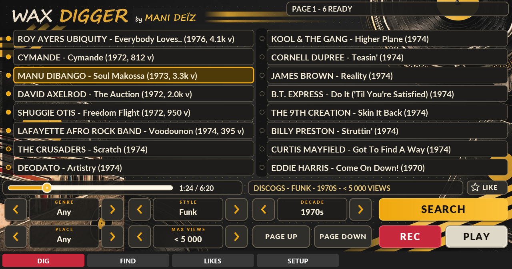
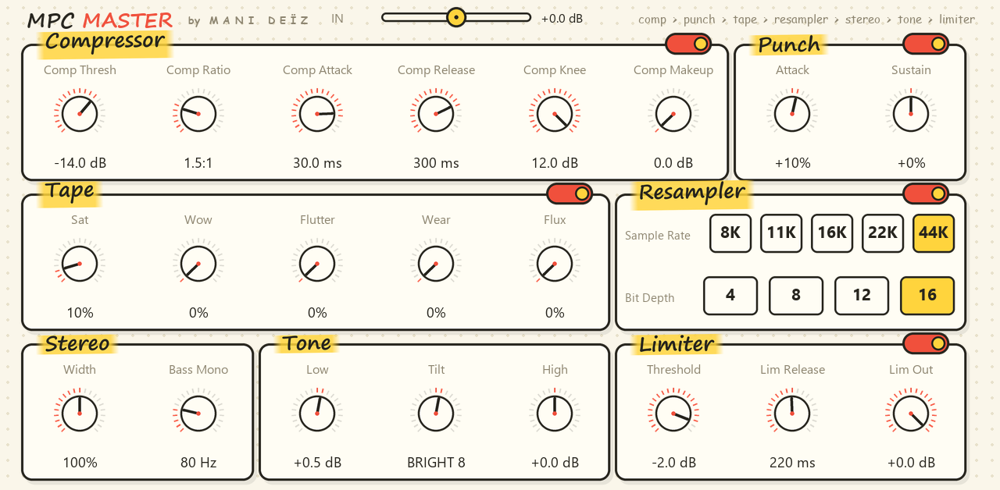
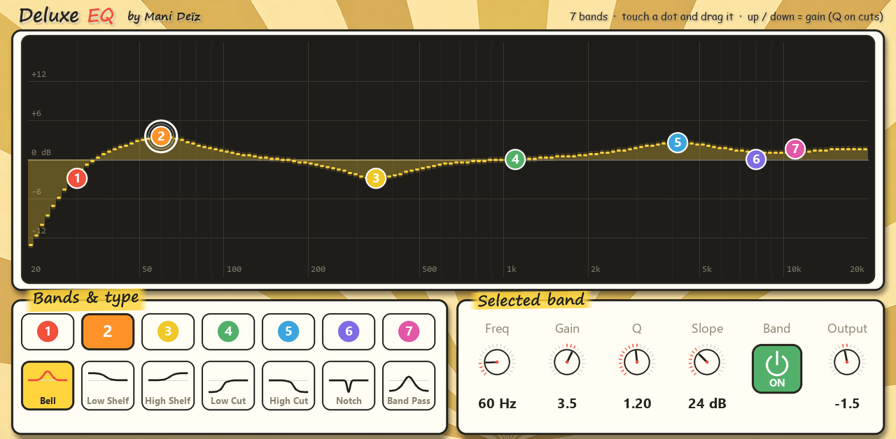

<h1 align="center">MANI DEÏZ</h1>

  <b>Plugins for the standalone MPC, made by a beatmaker.</b> 
  One screen, no menus, built on the machine they run on.

  <a href="https://manideiz.github.io/"><b>→&nbsp; manideiz.github.io</b></a>

  
  
  

---

## The plugins

<table>
  <tr>
    <td width="33%" valign="top" align="center">
      
      <h3>WAX DIGGER</h3>
      
<b>A record digger inside your MPC.</b> 
      Search, tap a title, hear it at once, record the part you want. Over Wi-Fi, no computer.

      

        
        
        
      

      
<a href="https://github.com/ManiDeiz/wax-digger"><b>Open the page&nbsp;→</b></a>

    </td>
    <td width="33%" valign="top" align="center">
      
      <h3>MPC MASTER</h3>
      
<b>A whole mastering chain on one screen.</b> 
      Compressor, punch, tape, 12-bit resampler, stereo, tone and a limiter that never clips.

      

        
        
      

      
<a href="https://github.com/ManiDeiz/mpc-master"><b>Open the page&nbsp;→</b></a>

    </td>
    <td width="33%" valign="top" align="center">
      
      <h3>DELUXE EQ</h3>
      
<b>A 7-band EQ you play with your finger.</b> 
      Touch a dot on the curve and drag it. Bells, shelves, steep cuts, notch and band-pass.

      

        
        
      

      
<a href="https://github.com/ManiDeiz/deluxe-eq"><b>Open the page&nbsp;→</b></a>

    </td>
  </tr>
</table>

## How to install a plugin

The same four steps for all of them:

1. Download the zip from the plugin's page and unzip it.
2. Copy the folder found inside `VST2 Plugins` into the `VST2 Plugins` folder at the root of your SD card or USB drive
   (create that folder if it is not there).
3. On the MPC: **Preferences → Enhancements (Beta)** → switch on *Enable Enhancements* and *External Plugin Support*.
4. Restart the MPC.

You need **MPC OS 3.10.1 or later**: older firmware cannot load third-party plugins.

## Found a bug?

Write to **[manideiz.plugins@proton.me](mailto:manideiz.plugins@proton.me)** with:

- your MPC model and its MPC OS version,
- what you did and what happened.

## Rights

The plugins are **© MANI DEÏZ, all rights reserved**. The free ones are free to use; please share the link to their page
rather than re-uploading the files.

They are independent plugins, not made, endorsed or supported by Akai Professional.
"MPC" and "Akai Professional" are trademarks of inMusic Brands, Inc.

MANI DEÏZ · beats, drums and tools

